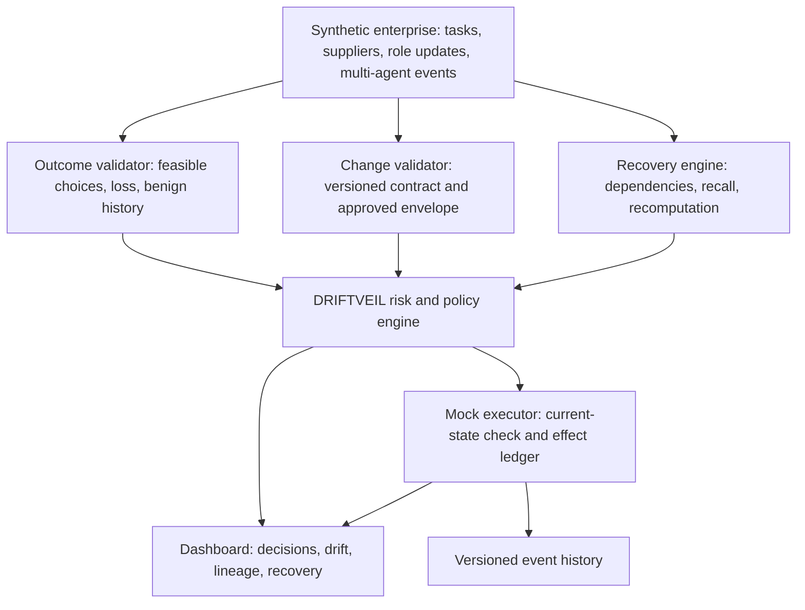

# 0. Document control and scope decision

**User-approved naming revision, 23 October 2026:** the three mechanisms are now named **OutcomeGuard**, **DriftGate**, and **ChainRestore**, respectively. This is a naming change; their requirements and prototype boundaries remain as specified below. The user also requested a Docker-packaged prototype API on Render and frontend hosting on Vercel; these hosting changes do not establish production enforcement or authenticated governance.

**Project:** DRIFTVEIL, formerly EXORCIST. **Challenge:** Identity Drift Detection in Autonomous AI Agents. **Revision:** 2.0, 22 October 2026. **Status:** agreed prototype strategy and build specification. The new mechanisms are not yet implemented or evaluated; the existing app remains a presentation shell with scripted scenarios until the acceptance checks below pass.

This is the authoritative PRD for the next iteration. It replaces the former four-USP strategy and real-agent/backend prerequisites. The previous PRD is preserved in [the archive](archive/02_EXORCIST_PRD_before_DRIFTVEIL_revision.md). See [the research review](DRIFTVEIL_USP_REVIEW.md) for related work and [the implementation plan](HACKATHON_PLAN.md) for code sequencing.

**Primary input:** the supplied two-page challenge PDF, `a65af2cb-cd0a-4be0-ad84-1d401c1dcdbb (1).pdf`, read in full. It requires learned normal behavior, role comparison despite valid credentials, explainable risk, selective restriction, legitimate evolution, cold start, agent chains, and gradual/normal-looking evasion. Judging weights, slide limits, deadline, and selection counts are not established by that PDF.

**Stage objective:** present a strong proposed solution supported by an inspectable synthetic-data proof of concept. Simulate enterprise data and agent proposals; actually execute validators, baseline calculations, graph analysis, policy decisions, and mock effects.

| Feasibility assessment | Qualitative planning estimate | Meaning |
|---|---|---|
| Synthetic-data prototype | 9/10 | Achievable with bounded workflows, existing UI, and deterministic core logic |
| Production implementation | 5/10 | Material integration, evidence integrity, coverage, enforcement, and operations work remains |

These are subjective planning estimates, not measured implementation outcomes, achieved security effectiveness, or promises of delivery.

# 1. Problem and proposed solution

An agent can retain valid credentials while hidden document instructions, poisoned tools, stolen tokens, or inherited context steer its behavior outside its intended purpose. Some harmful decisions use approved tools and normal access patterns. Legitimate updates can also look anomalous, and stopping one agent may leave contaminated state in another.

**Product definition:** DRIFTVEIL learns role- and task-specific behavior, checks whether decisions continue to serve approved business objectives, distinguishes narrowly approved evolution from unexplained drift, and verifies recovery across affected workflows.

**Core message:** **Catch harmful decisions that look normal. Let legitimate change through. Keep unaffected work running.**

The proposed enterprise product operates around controlled agent execution boundaries. The prototype is a local synthetic enterprise with computed decisions and a mock effect ledger. It does not claim protection of a real company, arbitrary natural-language intent understanding, or universal coverage.

# 2. Users, outcomes, and scope

| User | Need | Prototype evidence |
|---|---|---|
| Judge | Understand and test the mechanism | Change an input; inspect the recalculated result |
| SOC analyst | Understand what changed and why an action is held | Rules, baseline, task evidence, risk, uncertainty, timeline |
| Agent owner | Preserve useful work | Valid task completes while an unrelated unsafe operation is held |
| Platform engineer | Know the integration boundary | Structured action/contract records and explicit coverage |
| Security lead | Assess protection versus disruption | Synthetic prevention, false holds, completion, and recovery with denominators |

Success for this stage means all three core mechanisms react to changed inputs, prevented and executed effects are recorded separately, and the evidence supports the proposal honestly. A large fleet, additional dashboard modules, and production integrations are not required.

# 3. Three core USPs

## 3.1 USP 1 — OutcomeGuard: the centerpiece

**Question:** Does the agent still make decisions consistent with its assigned business purpose when credentials and tool usage look normal?

**Synthetic environment:** supplier offers with prices, quantities, delivery times, quality/eligibility attributes, and trusted source versions; purchasing tasks with an explicit objective and constraints; agent proposals selecting an offer.

**Required computation:**

1. Validate task, candidate records, and selection against trusted synthetic data.
2. Filter alternatives by all required constraints: supplier eligibility, quantity, deadline, quality, and any other declared material criterion.
3. Calculate task-relative loss against the best observed feasible alternative under the approved objective.
4. Apply explicit hard outcome limits independently of statistical risk.
5. Compare a sequence of losses with a frozen benign role/task reference to identify repeated unexplained deterioration.

The first template minimizes total landed cost subject to eligibility, quantity, quality, and delivery constraints. Use integer minor currency units. For positive best feasible cost:

`loss = max(0, chosenCost - bestObservedFeasibleCost) / bestObservedFeasibleCost`

If the best feasible cost is zero, use the absolute minor-unit gap and the task's absolute limit instead of dividing by zero. Missing material criteria, untrusted/stale required records, malformed values, no feasible alternatives, or an infeasible choice produce an explicit unresolved/violation result. They do not become assumed zero-loss decisions.

**Example:** A costs INR 1,000 and arrives in five days; B costs INR 1,300 and arrives in five days. If all approved criteria are equal and the deadline is seven days, B has 30% task-relative loss. If the deadline is two days and C costs INR 1,500 but arrives tomorrow, C can be the correct minimum-cost feasible choice. Higher price alone is not drift.

**Learning:** derive a loss reference from separate approved benign traces, conditioned on role/task family and version. Use a simple cumulative statistic, for example `C_t = max(0, C_(t-1) + loss_t - benignMean - allowance)`, with allowance and alert threshold selected on validation data. Record the first alert window. Also learn tool-transition frequencies, so the product remains a behavioral identity detector rather than only an optimizer.

**Judge proof:** valid credentials and normal tools remain unchanged while an inappropriate selection produces an objective violation or cumulative alert. Change supplier prices, delivery constraints, eligibility, or selection and recompute. Include a valid urgent purchase as a negative control.

**Value hypothesis:** catch costly misuse and errors that tool allowlists cannot distinguish.

**Limits:** objective inconsistency is not proof of malicious intent, and the comparator covers observed alternatives, not the entire market. This bounded task template is not a universal optimizer. The proposed extension is longitudinal task-relative identity monitoring with independent evidence and pre-effect response; outcome validation itself is not new. Compare against a simple task-rule validator to establish incremental value.

## 3.2 USP 2 — DriftGate

**Question:** Does a deviation fit the precise scope of an approved role change, or is unrelated behavior being normalized alongside it?

**Synthetic environment:** activity before and after a legitimate update, with an authorized payment-scheduling tool and an unexplained bank-details export appearing simultaneously.

**Required computation:**

1. Keep the active Role Contract, frozen benign reference, and approved change envelope as separate versioned objects.
2. Check completed approvals, agent/task applicability, old/new versions, and effective time.
3. Compare each action's tool, resource/data class, destination, and task scope with the exact approved delta.
4. Distinguish hard violations, change-compatible deviations, unexplained deviations, and insufficient evidence.
5. Preserve references and prohibitions on untouched dimensions. Exclude blocked/suspected traffic from benign learning.
6. Build a candidate reference from approved clean traces and promote it after validation; do not reset the whole profile because an update exists.

Where enough clean data exists, the envelope also records expected behavioral ranges. Approval permits specified operations; it does not automatically establish that a new behavior distribution is benign. Missing history is visible while hard contract checks remain active.

**Judge proof:** scheduling passes only in its approved payment-terms scope; unrelated bank-details export remains held. Adding an authorized operation changes its applicable decision. A scenario's `legitimate` label cannot bypass evaluation.

**Value hypothesis:** reduce false holds during legitimate evolution while preserving detection of unrelated scope creep and baseline poisoning.

**Limits:** compatibility with an approval is not causal proof that the update caused the behavior. Dynamic policies and approved baselines already exist. The proposed improvement is bounded task-aware adaptation, tested under mixed update-plus-attack conditions, with an intact security anchor.

## 3.3 USP 3 — ChainRestore

**Question:** Which derived state and pending actions must remain held, and what useful work can be verified to continue?

**Synthetic environment:** `Poisoned PDF -> Procurement Summary -> Finance Memory -> Pending Payment`, plus an independent valid purchase workflow and trusted replacement records.

**Required computation:**

1. Traverse recorded dependencies to identify known affected descendants and pending actions.
2. Invalidate contaminated state for future execution while preserving historical evidence.
3. Hold affected effects and check current source/policy state before mock commit. Stale approvals cannot override recall.
4. Represent missing provenance as unresolved exposure; a missing edge does not prove an artifact is clean.
5. Recompute necessary state from validated synthetic records or a clean checkpoint, through the same validators.
6. Verify repaired paths, business output, and prohibited-effect ledger before permitting a newly valid action.
7. Continue independently supported work that still satisfies policy.

**Judge proof:** the risky payment stays held, affected computation is regenerated from trusted inputs, and an independent purchase completes. Change a dependency in a fresh/forked fixture and recompute recovery scope. Report held, repaired, verified, and unresolved states separately.

**Graph-edit boundary:** topology edits change synthetic inputs for a new evaluation. Deleting a visual edge or historical dependency cannot cleanse an already contaminated artifact. Recorded lineage remains; actual release requires validated recomputation or an explicitly supported clean dependency path. A status badge alone is not recovery.

**Value hypothesis:** prevent recurrence through inherited state while avoiding unnecessary shutdown of unrelated workflows.

**Limits:** recall cannot undo a disclosed secret, delivered email, or committed payment. Atomic source/authority/effect ordering is demonstrated only inside the controlled mock executor. Dependency repair and execution fencing have prior art; the candidate contribution is their measured combined recovery behavior under stale state, retries, and uncertainty.

# 4. Challenge coverage and supporting mechanisms

| Challenge demand | Mechanism | Required synthetic evidence |
|---|---|---|
| Valid credentials hide misuse | Identity validation separate from role/task/outcome | Valid token, inappropriate decision held |
| Learn normal behavior | Benign tool transitions and loss reference | Actual sample counts, calculated statistics, reference version |
| Continuous declared-role comparison | Shared evaluator on consequential proposals/effects | Every mock read/write/export/payment checked |
| Hidden document instruction | Controlled contaminated source and observed lineage | Proposed actions cause evaluated consequences; prose is not a verdict |
| Poisoned tool | Synthetic tool manifest/version and scope validation | Changed/unapproved consequential operation held |
| Stolen token | Mock action/credential reconciliation | Valid identity without matching execution authority held |
| Legitimate evolution | Approved envelope and reference governance | Scheduling passes; unrelated export does not |
| Cold start | Contract first; approved role/task prior | Hard constraints apply without history; confidence explicit |
| Agent chains | Inherited scope, dependencies, and recall | Child cannot broaden originating task authority |
| Imitation / slow drift | Outcome loss plus transition/window statistics | Same tool path, worsening choices, measured alert delay |
| Explain risk | Versioned signals, reasons, evidence status | Decision can be reconstructed |
| Preserve useful work | Scoped response and verified continuation | Clean output completes while affected action stays held |

**Supporting mechanisms:** Role Contracts, explainable scoring, credential reconciliation, selective containment, purpose-bound data-flow checks, and Ghost Replay. Decoys are optional corroboration, not a fourth USP.

Credential reconciliation checks agent/session/action/resource/arguments and current contract authority. A missing reasoning span or unusual IP alone is not proof of theft. Mock receipt matching does not establish production cryptographic identity. Approved retries use explicit idempotency and cannot duplicate a committed effect.

Ghost Replay, when implemented, reruns the synthetic planner/executor under original and sanitized inputs. It distinguishes proposal reproduction from effect execution; failure to reproduce the original proposal yields inconclusive attribution. Repeated identical deterministic runs are not independent statistical samples or evidence of real LLM behavior.

# 5. Functional requirements and priority

## P0 — required for the three-USP proof of concept

| ID | Requirement | Acceptance check |
|---|---|---|
| FR01 | DRIFTVEIL branding and explicit simulated/computed state | Synthetic enterprise labeled; fixture history not relabeled measured results |
| FR02 | Trusted supplier/task/resource records and input validation | Invalid money, missing criteria, unknown consequential resources, and stale evidence cannot silently pass |
| FR03 | Shared contract/task/policy evaluator | Verdict depends on action/policy, never scenario truth labels |
| FR04 | Deterministic outcome validator | Feasible alternatives/loss recomputed; urgent valid purchase and ties pass |
| FR05 | Benign reference and cumulative drift | Separate data splits; actual counts/history and calculated alert window |
| FR06 | Contracts, approval state, and bounded envelopes | Pending change does not authorize; approved delta affects exact scope only |
| FR07 | Dependency graph and recall traversal | Descendants held; independent path unaffected; missing lineage unresolved |
| FR08 | Recovery recomputation and checker | Fresh validated artifacts/output required before release |
| FR09 | Controlled mock executor, current-state checks, effect ledger, idempotency | Denied read yields no data; denied payment/export no effect; retries no duplicates |
| FR10 | Explainable risk and Allow / Hold / Restrict | Hard gates independent of aggregate risk; uncertainty visible |
| FR11 | Interactive input-driven demonstrations | Price/deadline, envelope, and fresh-fixture dependency edits recalculate results |
| FR12 | Consistent dashboard and evidence | Decision comparison, drift chart, lineage, incident, recovery agree on run |
| FR13 | Measured evaluation and export | Denominators, false holds, completion, failures, seed, and engine version |

Represent the named attack vectors through synthetic document contamination, changed tool/operation, and credential/action mismatch. Production integrations for those vectors are not required.

## P1 — supporting proofs after P0

Computed Ghost Replay, richer mock receipt/manifest cases, canary invocation, additional business-task templates, and broader replay controls. Existing views can remain fixture-only if clearly labeled. Do not divert effort from the three core proofs to expand modules.

## P2 — enterprise roadmap

Real LLM/framework adapters, protected API/MCP gateways, production identity and signed receipts, durable audit storage, authenticated approvals, tenant isolation, enterprise telemetry, failover, real revocation semantics, SIEM integrations, and independently validated policies/performance. These are future work, not prototype blockers.

# 6. Prototype architecture and stack

Shared trusted context connects the validators. All recomputed recovery actions pass through policy and the mock executor again; recovery cannot execute unvalidated effects.

| Need | Prototype choice | Scope |
|---|---|---|
| UI | Existing React, TypeScript, Vite, Tailwind, React Flow/Recharts | Reuse current design/pages |
| State | Existing Zustand and browser persistence | Local simulation, not production trust boundary |
| Validators | Small pure TypeScript functions and structured records | Standard arithmetic, policies, graph traversal; no new dependency needed initially |
| Enterprise simulator | Fixed-seed records and action proposals | Expected outcomes kept separately from detector inputs |
| Learning | Transition frequencies and outcome statistics | No foundation-model training or GPU dependency |
| Effect prevention | Controlled in-process mock tools and effect ledger | Real policy logic prevents synthetic effects |
| Evaluation | Focused assertions and repeatable scenario runner | Measured synthetic results and regression checks |

**Not required:** real autonomous agents, hosted LLMs, LangGraph, FastAPI, a database server, Docker, cloud deployment, or production security infrastructure. Add a service only when testing an integration boundary requires it.

Production would move trusted policy, approvals, authoritative data, audit state, and enforcement outside the browser/agent runtime. Browser state is operator-editable; no tamper-resistance guarantee is claimed.

# 7. Data model and simulation contract

Use existing types where practical; minimum logical records are:

| Record | Essential fields |
|---|---|
| Agent | ID, role, owner, credential reference, contract/reference versions, scope/status |
| Task | ID/family, objective, quantity, delivery/quality/eligibility requirements, outcome limits, scope |
| Offer | ID, minor-unit cost, quantity/delivery/quality, eligibility, source/version |
| Action | ID, agent/session/task, tool, arguments/resource/data class, destination, input artifacts, time |
| Contract | ID/version/status, allowed/prohibited tools/resources/data/destinations/task families |
| Change | ID, approvals, old/new versions, affected agent/task/scope, effective time, expected delta |
| Baseline | ID/version, role/task family, approved sample count, transition frequencies, loss statistics |
| Artifact | ID/kind, recorded parents, source/version, validity, provenance-completeness status |
| Decision | Action ID, result, reasons, signals/status, score, rule/reference/source versions |
| Effect/receipt | Action binding, current execution authority, idempotency key, held/committed result |
| Recovery | Run/incident, affected/unresolved paths, regenerated artifacts, output assertions, residual effects |

**Input/output separation:** the simulator may prescribe proposed actions but cannot supply security verdicts. Ground-truth attack labels and expected results belong to test fixtures, never evaluator inputs. Scenario IDs, titles, stage labels, and `legitimate` flags cannot govern decisions.

Attacker narrative is evidence. Unless an explicitly implemented synthetic planner consumes it, changing wording is not a demonstration of semantic attack detection. Structured action, task, and environment editors provide the required input-sensitivity proof.

Resource classifications and authoritative data come from the mock registry, not attacker assertions. A denied read returns no sensitive value; later steps cannot pretend that blocked data was obtained. Workflow branches must follow actual mock tool results.

Events and effects are associated with a run/snapshot. An edit invalidates stale pending assessments and triggers a fresh evaluation or sandbox run. Historical lineage and committed effects are retained. Existing browser state needs migration or a disclosed reset before computed runs; old scripted results must not be relabeled computed.

# 8. Risk, policy precedence, and explanations

Retain the existing explainable aggregation shape where useful:

`rawRisk = 100 * (1 - product(1 - weight_i * signal_i))`

Derive signals from evaluated inputs/history, validate/clamp values to [0,1], and version weights and derivation rules. Signals cover role/scope deviation, outcome loss/deviation, sequence anomaly, cumulative drift, prohibited data flow, credential mismatch, and optional canary contact. Track missing evidence separately rather than silently assigning zero risk or a confident healthy verdict.

Display bands 0–39 Observe, 40–59 Step-up, 60–79 Restrict, and 80–100 Quarantine may be retained initially. These are configurable, untuned policy heuristics; a score of 92 is not a 92% probability of attack.

**Precedence:**

1. Explicit prohibitions, invalid/revoked required authority, or a hard task-objective violation hold/deny the effect regardless of risk score.
2. Missing required evidence holds the relevant consequential action with an unresolved explanation.
3. Behavioral anomalies request review or scoped restriction according to policy; unusual behavior alone does not prove compromise.
4. Otherwise allow the evaluated action within its scope.

An approved change affects only its delta. Analyst release does not expand a contract or override a hard prohibition. Disabling automatic behavioral holds does not disable mandatory policy gates. Broad quarantine is not the automatic response to every anomaly.

Expose the objective, feasible alternatives, calculated loss, applicable envelope, reference count/version, dependency path, reason codes, effect result, and uncertainty. Distinguish observed events, computed findings, inferred influence, replay outcomes, and analyst decisions.

# 9. Interactive demo and user journey

Reuse the dashboard, Lab, contracts/changes, incidents, drift, lineage, and recovery views. Prioritize inspectable evidence over new pages or animation.

| Demo | Editable input | Required response |
|---|---|---|
| OutcomeGuard | Prices, deadline, eligibility/quality, selected supplier | Recompute feasible alternatives, loss, hard limits, and decision; use the appropriate task reference |
| DriftGate | Approved tool/resource/task scope and approval state | Re-evaluate applicability; unrelated export remains held |
| ChainRestore | Source validity or dependency in a fresh fixture | Recompute affected descendants; preserve historical contamination evidence |

Walkthrough:

1. Show a benign task completing under a visible contract and learned reference.
2. Keep credentials/tools normal; introduce an inappropriate selection and inspect loss/history.
3. Change a constraint to make an expensive urgent purchase valid; observe recomputation.
4. Apply approved scheduling alongside an unrelated export; inspect separate decisions.
5. Recall the poisoned source across two agents; show the held payment, validated repair, and independent completion.
6. Inspect a synthetic evaluation report with denominators, negative controls, and failures.

Scenario presets initialize conditions, not guaranteed alerts. Separate computed run results from seeded history. Replace or clearly label invented containment latency and fixed performance counters.

# 10. Evaluation and acceptance

## 10.1 Splits and comparisons

Use separate fixed-seed benign reference, validation, and held-out evaluation data. Select thresholds before held-out evaluation. Expected outcomes are defined independently. Vary actual feasible sets, objectives, actions, task mix, sources, timing, and graph structure; unused prose variations are not attack diversity.

Minimum planned suite: 20 held-out benign sessions, 12 varied attack/violation attempts across the USPs, stable and gradual-drift streams, a legitimate-update stream with an attack alongside it, and cold-start/uncertainty cases. These are targets, not achieved results or strong enterprise statistical evidence.

| USP | Baselines | Incremental question |
|---|---|---|
| Outcome | Tool/domain-only; task-rule validator; validator plus history | Does history detect subtle deterioration beyond hard-rule violations without excessive false holds? |
| Change | Frozen; naive rolling; whole-profile reset; bounded envelope | Does scoped adaptation retain valid updates without learning away unrelated drift? |
| Recovery | Source deletion; whole-agent hold; dependency repair; full recovery | Are residual effects reduced while useful work and recovery cost remain acceptable? |

Compare a real semantic alignment checker only if actually executed. Local baseline configurations do not stand for the entire capability of commercial products.

## 10.2 Metrics

| Metric | Definition |
|---|---|
| Alert recall | Alerted attack/violation sessions / all evaluated attack/violation sessions |
| Prohibited-effect prevention | Prohibited attempts held before mock effect / all evaluated prohibited attempts |
| False holds | Known permitted benign sessions incorrectly held / all evaluated benign sessions |
| Legitimate completion | Valid business outputs completed / attempted legitimate tasks, including continuations |
| Outcome-history contribution | Additional held-out detections beyond task-rule baseline and added false holds |
| Drift delay | First alert window minus known onset; include missed streams |
| Recovery | Affected paths found, residual effects, unnecessary holds/invalidation, verified outputs |
| Cost | Checks, authoritative mock lookups, replay/recomputation per task |
| Local latency | Measured evaluator/recovery time with environment/workload disclosed |

Separate alerts from prevented effects and correctly held unresolved actions from confirmed violations. Report uncertainty's interruption cost. Unassessable cases and failures stay in denominators with their disposition. Browser computation time is not production gateway latency.

## 10.3 Mandatory behavioral checks

1. Supplier edits recalculate decisions; urgency, quality tradeoffs, ties, invalid/zero money, and no feasible choice are handled.
2. Missing/untrusted material evidence cannot yield a confident allow for an otherwise unverified effect.
3. Repeated small losses can cross a calculated threshold; matched stable traces are evaluated too.
4. Approved scheduling passes only in scope; pending, wrong-resource, wrong-task, and export cases remain held.
5. Scenario labels, narrative, and expected-outcome flags cannot alter evaluator results.
6. Cold-start agents obey hard policy; blocked/suspected history cannot contaminate the reference.
7. Recall reaches recorded descendants, preserves history, and keeps justified independent work usable.
8. Missing lineage is unresolved; hiding a historical edge cannot release an artifact.
9. Recovery rechecks replacement evidence/current authority; stale approvals, late writes, restarts, and retries cannot restore invalid mock execution.
10. Denied reads/exports/payments produce no prohibited effect; approved duplicate retries do not duplicate effects.
11. Settings affect intended behavioral controls without disabling hard gates.
12. UI and export agree on run, decisions, and policy/source/engine versions.

**Release gates:** three computed input-sensitive proofs; one prohibited effect actually prevented in the mock world; independent or repaired legitimate work completed; negative controls/failures reported; no invented measured claims.

# 11. Scalability and organization impact

Compile validators per task template; maintain bounded role/task/version statistics incrementally; reuse approved cohort priors without pooling private tenant data; index graph dependencies; batch/deduplicate authoritative checks by tenant/source/policy version and freshness; partition analysis by tenant/workflow; eventually enforce near protected sinks.

For n observed alternatives and k fixed criteria, direct outcome validation is O(nk). Explicit affected-region graph traversal is O(Va + Ea). These are bounded algorithmic properties, not measured throughput or claims about arbitrary optimization. Shared-source fanout, provenance growth, authoritative-data latency, invalidation, and context cardinality can dominate deployment cost.

Scale tests should increase trace volume, task variety, queue length, graph depth/fanout, and shared-source hot spots. Measure throughput, p50/p95 latency, memory growth, checks, false holds, and completion. Thousands of synthetic graph nodes do not demonstrate thousands of deployed autonomous agents. Never improve a benchmark by skipping required freshness/policy checks.

**Initial use case:** controlled procurement/accounts-payable workflows with explicit objectives, current supplier/approval records, and known execution boundaries. Potential impact is fewer inconsistent decisions, fewer false holds during valid changes, and less interruption during response. Refunds, provisioning, and releases require separately approved templates and evidence.

**Commercial hypothesis:** AI platform/security teams may value auditable protection that improves security and retained task utility. A future gateway or self-hosted service would complement existing IAM/DLP. Pricing, willingness to pay, actual incident reduction, and saved analyst hours require customer evidence. Synthetic monetary gaps are not actual fraud prevented or proven ROI.

# 12. Build sequence

| Phase | Deliverable | Exit check |
|---|---|---|
| 1 | Typed mock records, evaluator, controlled tools/effect ledger | Benign task completes; prohibited operation creates no effect |
| 2 | Outcome witness, loss/transition reference, cumulative history | Urgent valid choice passes; inappropriate choice/history recalculate |
| 3 | Versioned envelope and scoped reference governance | Scheduling and unrelated export produce different results |
| 4 | Recall, current-state fences, recovery recomputation/assertions | Affected payment held; validated repair and independent work complete |
| 5 | Reused UI, input editors, explanations/reports | Edits change results; seed history remains distinct |
| 6 | Held-out evaluation, scale checks, walkthrough/slides | Repeatable demos and measured synthetic report |

Do not promise fixed hours without deadline/team capacity. Prefer these bounded phases over an app rewrite or full backend. The [implementation companion](HACKATHON_PLAN.md) identifies callers and persistence concerns.

# 13. Innovation and related work

| Proposed contribution | Relevant prior work | Required evidence |
|---|---|---|
| OutcomeGuard | [Progent](https://arxiv.org/html/2504.11703v2), [recommendation drift](https://arxiv.org/abs/2603.12564), [ProcureBench](https://github.com/immu4989/dspy-security-bench/blob/main/ARCHITECTURE.md) | Longitudinal task-relative identity detects deterioration beyond a simple task-rule baseline |
| DriftGate | [DRIFT](https://arxiv.org/abs/2506.12104), [approved baseline management](https://deterministicagents.ai/controls/c19-model-behaviour-monitoring) | Narrow adaptation handles legitimate update plus unrelated attack better than reset/rolling learning |
| ChainRestore | [dependency repair](https://arxiv.org/abs/2608.10502), [PolyGraph](https://arxiv.org/abs/2610.17719), [CONTINUITY](https://arxiv.org/abs/2609.05269) | Response remains correct under inherited state, queued effects, retries, and missing lineage while retaining work |

The proposal extends and integrates established ideas. It does not claim invention of contracts, outcome validation, replay, provenance, or recovery. Commercial platforms already advertise contextual protection; public omissions are not verified missing features. See [the research review](DRIFTVEIL_USP_REVIEW.md) for the fuller landscape.

If an addition brings no measured benefit over its closest simpler baseline, reduce the claim to useful integration engineering. Do not claim global firstness, guaranteed competition placement, calibrated compromise probability, compliance certification, or superiority to untested products.

# 14. Limits and production transition

Use synthetic records only. Validate editor inputs and boundaries; preserve recorded evidence/effects; show unknown coverage. Browser persistence and mock receipts are inspectable local state, not tamper-proof audit records.

Incomplete objectives/source truth can defeat outcome checks. New tasks may lack a reference. Compromised approvals can widen scope. Missing lineage limits attribution. Shared sources can broaden containment. External effects may be irreversible; uninstrumented bypasses are outside the mock guarantee.

Production requires trusted adapters, authenticated approval governance, authoritative data integrity, durable event/effect storage, tenant isolation, real identities/receipts, controlled tool/network access, target-supported execution checks, failure handling, and independent security testing. Real-agent/adaptive-attack tests are later milestones, not capabilities inferred from synthetic success.

# 15. Presentation and claims

Adapt the narrative to the actual submission rules:

1. Valid credentials and normal tools can produce a harmful business decision.
2. Explain the three-USP architecture using one connected workflow.
3. Demonstrate OutcomeGuard, including an urgent legitimate counterexample.
4. Demonstrate approved change and verified cross-agent recovery.
5. Present synthetic results, denominators, negative controls, and scale tests actually run.
6. Explain organization impact hypotheses, coverage limits, and production roadmap.

**Feasibility-slide wording:** "DRIFTVEIL's core innovations can be demonstrated using synthetic enterprise workflows, deterministic outcome validators, versioned role policies, and dependency-graph analysis without requiring production integrations or training a large AI model."

Label planned work as proposed, seed history as illustrative, and measurements as synthetic prototype results. The 9/10 feasibility estimate is not achieved performance. UI, report, and slide numbers must agree.

# 16. Current implementation status

The existing frontend computes risk aggregation over preset signals, while scenario decisions, replay outcomes, and several metrics are scripted. The three new mechanisms, learned references, and recovery checks remain requirements until section 10 passes.

The next implementation artifact is a computed synthetic workflow with independently checked decisions and a mock effect ledger. This PRD revision does not claim that product changes, benchmarks, or real integrations have shipped.
